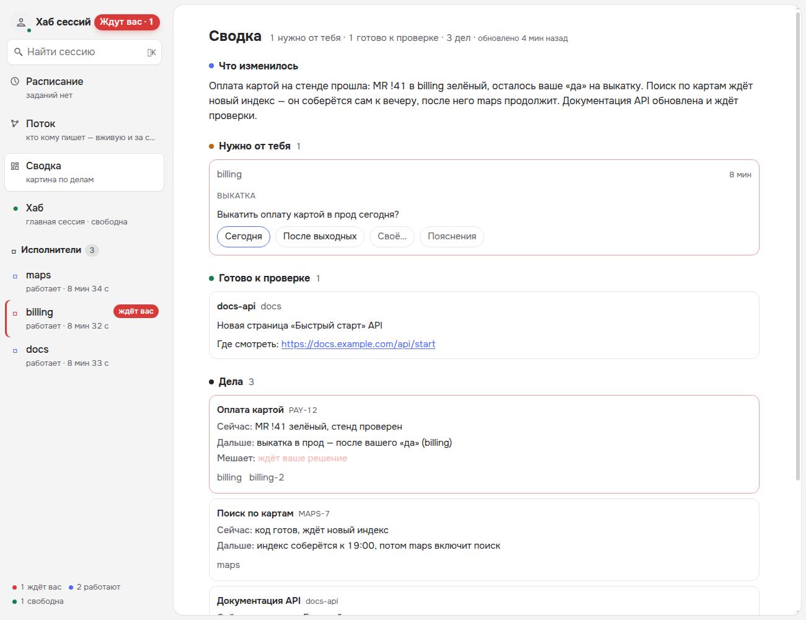

# «Сводка» — плагин страницы Agents Hub



Картина ваших дел на одном экране, а не список сессий. Дело — то, чем занимаются (задача, MR, тема): одно дело часто
ведут несколько сессий, и связать их — работа плагина, а не ваша.

- **Что изменилось** — 2–4 предложения: что сдвинулось и что из этого следует.
- **Нужно от тебя** — открытые вопросы сессий (отвечаете прямо здесь) и решения, которые нашлись в репликах: почему
  нужны именно вы и что советуют.
- **Готово к проверке** — что сдано вам и где смотреть.
- **Дела** — где каждое сейчас, что дальше и кто, что мешает, кто ведёт (ссылки в ленты). «новое» — с прошлого «Прочитал».
- **Сейчас работают** — кто занят прямо сейчас.

## Как работает

Процесс плагина (`cases.py`) читает журнал хаба за 36 ч: реплики сессий, сообщения, вопросы и ответы. Есть новое и
прошло не меньше 10 минут — один вызов `claude -p` (по умолчанию Sonnet, без инструментов): прошлая картина + новое →
новая картина. Раз в 6 ч — сборка с нуля. Итог — `out/picture.json`, страница берёт его раз в 10 с; сбой модели —
картина остаётся прежней.

**Стоимость:** около $0.06 за обновление, не чаще раза в 10 минут и только когда во флоте есть новое — до ~$9 в сутки
при непрерывной работе; тратится ваш аккаунт Claude. Реже — `DESK_GAP`.

## Установка

Plugin API ^1.7. В «Настройки → Плагины» или записью в `extensions` настроек хаба:

```json
"desk": {"path": "<папка плагина>", "web": "main.js", "hub": "^1.7", "run": ["python3", "cases.py"]}
```

Настройки (переменные окружения процесса): `DESK_GAP` — не чаще, с (600), `DESK_FULL` — сборка с нуля, с (21600),
`DESK_PICTURE_MODEL` — модель (sonnet). Тесты: `HUB_REPO=<ядро> python3 -m unittest test_cases`.
